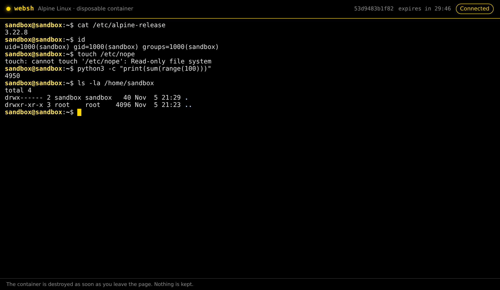

# websh : a disposable Linux shell in the browser

websh gives every visitor a throwaway Linux shell in a web page. Each page load starts an isolated Alpine container and connects it to an xterm.js terminal over a WebSocket. The container is destroyed when the tab closes, the connection drops, or the session times out.

⚠️ The server mounts the Docker socket, which is equivalent to root access on the host. Do not expose it to the Internet without authentication in front of it.

## Environment variables

| Variable | Default | Description |
| --- | --- | --- |
| `PORT` | `3000` | HTTP port |
| `HOST` | `0.0.0.0` | Listen address |
| `DOCKER_SOCKET` | `/var/run/docker.sock` | Path to the Docker socket |
| `MAX_CONTAINERS_PER_IP` | `10` | Maximum concurrent containers per client |
| `MAX_CONTAINERS_TOTAL` | `50` | Maximum concurrent containers overall |
| `TRUST_PROXY` | `false` | Read the client IP from `X-Forwarded-For` (only enable behind a reverse proxy) |
| `ALLOWED_ORIGINS` | – | Comma-separated origins allowed to open a WebSocket (default: same host as the page) |
| `SANDBOX_IMAGE` | `websh-sandbox:latest` | Image used for sessions |
| `SANDBOX_SHELL` | `/bin/bash,-l` | Command to run, comma-separated |
| `SANDBOX_MEMORY` | `256m` | Memory limit per session |
| `SANDBOX_CPUS` | `0.5` | CPU limit per session |
| `SANDBOX_PIDS` | `128` | Maximum processes per session |
| `SANDBOX_TMP_SIZE` | `64m` | Size of the `/tmp` and home tmpfs mounts |
| `SANDBOX_NETWORK` | `none` | Docker network for sessions |
| `SANDBOX_RUNTIME` | – | OCI runtime, e.g. `runsc` for gVisor |
| `SESSION_MAX_SECONDS` | `1800` | Maximum session lifetime |
| `SESSION_IDLE_SECONDS` | `600` | Idle timeout (`0` = never) |
